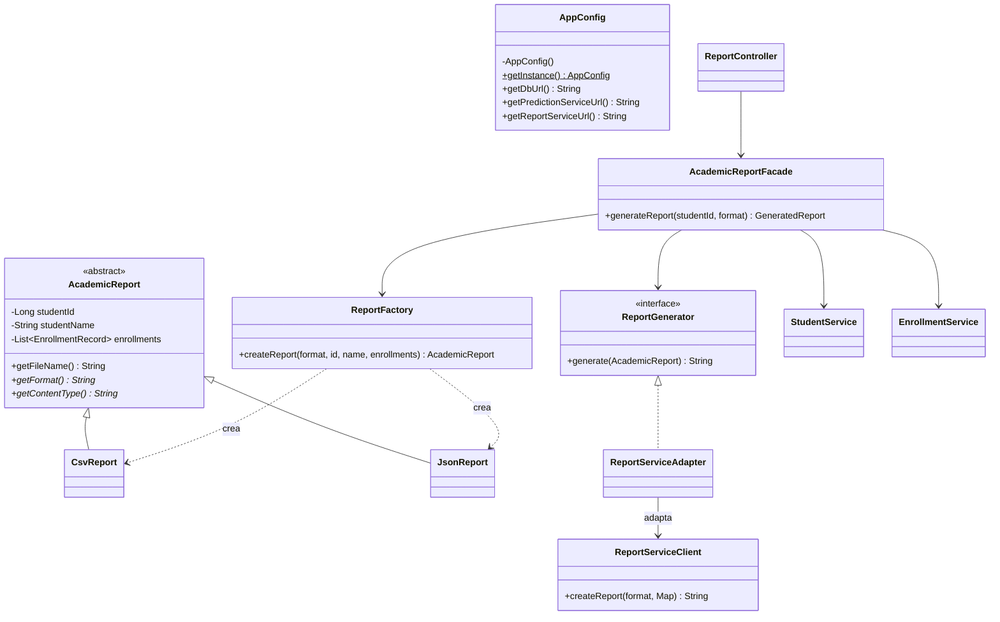

# Práctica 7 – Planificación Scrum y diseño

> Documento de trabajo del equipo. Rellenad los nombres y mantened el tablero actualizado.

## Roles

| Rol | Integrante |
|-----|------------|
| Scrum Master | _(por decidir)_ |
| Equipo de desarrollo | _(todos los integrantes)_ |

## 1. Product Backlog

| ID | Historia | Componentes | Prioridad | SP |
|----|----------|-------------|-----------|----|
| HU-03 | Configuración centralizada (Singleton `AppConfig`) | Backend, Compose | Alta | 2 |
| HU-01 | Gestión de cursos académicos (CRUD) | MySQL, backend, frontend | Alta | 5 |
| HU-02 | Matrículas y calificaciones históricas | MySQL, backend, frontend | Alta | 8 |
| HU-04 | Informes: clase abstracta + Factory | Backend | Media | 3 |
| HU-05 | Microservicio de informes + Adapter | Python, backend, Compose | Media | 5 |
| HU-06 | Generación de informes mediante Facade | Backend, frontend | Media | 5 |

### Dependencias

```
HU-03 (AppConfig) ─────────────────────────────┐
                                               ▼
HU-01 (Course) ──► HU-02 (Enrollment+grade) ──► HU-06 (Facade + UI) ◄── HU-04 (AcademicReport/Factory)
                                               ▲
                     HU-05 (report-service + Adapter)
```

- HU-02 necesita la entidad `Course` (HU-01).
- HU-05 necesita la URL del servicio de informes centralizada en `AppConfig` (HU-03).
- HU-06 integra todo: datos históricos (HU-02), objetos de informe (HU-04) y adaptador (HU-05).
- El microservicio Python de informes (HU-05) se puede desarrollar en paralelo desde el inicio
  acordando antes el contrato JSON (`student`, `records`, `name`, `academic_year`, `score`).

## 2. Tareas técnicas

### HU-03 · Singleton `AppConfig`
- T-01 Clase `AppConfig` con constructor privado y `getInstance()` (`synchronized`).
- T-02 Lectura de variables de entorno, con valores por defecto para trabajar en local.
- T-03 Crear la conexión a MySQL (`DataSource`) y los clientes HTTP a partir de `AppConfig`.
- T-04 Test: dos llamadas a `getInstance()` devuelven la misma instancia.

### HU-01 · Cursos académicos
- T-05 Entidad `Course` con relación `@ManyToMany` con `Subject` (un curso tiene varias asignaturas).
- T-06 Campos: id, nombre, fecha de inicio, fecha de fin y asignaturas que se imparten.
- T-07 CRUD `GET/POST/PUT/DELETE /api/courses`.
- T-08 Validaciones: nombre único (409), fin posterior al inicio (400), no borrar con matrículas (409).
- T-09 Pestaña "Cursos" en la interfaz web (alta, edición, borrado, asignaturas ofertadas).

### HU-02 · Matrículas históricas
- T-10 Añadir a `Enrollment` el curso, la nota y la restricción única (estudiante, asignatura, curso).
- T-11 Solo se puede matricular en asignaturas que se imparten en ese curso.
- T-12 `POST /api/enrollments`, `PUT /api/enrollments/{id}` (horas y nota), `DELETE /api/enrollments/{id}`.
- T-13 `GET /api/students/{id}/enrollments`: historial completo ordenado por curso.
- T-14 Calificación opcional entre 0 y 10; la matrícula se puede crear sin nota.
- T-15 Las predicciones (`GET /api/students/{id}/predictions`) usan las horas de cada matrícula.
- T-16 Interfaz: selección de curso al registrar estudiante, pestaña "Matrículas" con historial y notas.

### HU-04 · `AcademicReport` + `ReportFactory`
- T-17 Clase abstracta `AcademicReport` (estudiante, matrículas, nombre del fichero; formato y tipo abstractos).
- T-18 `CsvReport` y `JsonReport`.
- T-19 `ReportFactory`: crea el informe según el texto `csv`/`json`; otro formato → 400.

### HU-05 · `report-service` + Adapter
- T-20 Microservicio FastAPI `POST /reports/{format}` (CSV y JSON) con tests pytest.
- T-21 Añadirlo a `docker-compose.yml` con *healthcheck*.
- T-22 Interfaz `ReportGenerator` (lo que necesita la aplicación).
- T-23 `ReportServiceClient` (cliente del microservicio, trabaja con el formato de Python).
- T-24 `ReportServiceAdapter` que implementa `ReportGenerator` y traduce `studentId/enrollments/subject/course/grade`
  → `student/records/name/academic_year/score`.

### HU-06 · `AcademicReportFacade`
- T-25 Fachada con `generateReport(studentId, format)` que coordina repositorios, factoría y adaptador.
- T-26 `GET /api/reports/students/{id}?format=csv|json` (el controlador solo llama a la fachada).
- T-27 Errores: estudiante inexistente (404), formato no admitido (400), fallo del microservicio (503).
- T-28 Pestaña "Informes": seleccionar estudiante y formato y descargar.

## 3. Historias técnicas añadidas por el equipo

| ID | Historia técnica | Justificación |
|----|------------------|---------------|
| HT-05 | Asignaturas impartidas en cada curso (`@ManyToMany`) | El enunciado dice que un curso contiene varias asignaturas y una asignatura puede estar en varios cursos. |
| HT-06 | Script de datos de demostración (`scripts/seed_demo.py`) | Permite probar historial, notas e informes rápidamente en cualquier ordenador. |
| HT-07 | Tests unitarios de los patrones | Comprobar Singleton, Factory y Adapter sin levantar la base de datos. |

> Al pasar de la P6 a la P7 cambia la estructura de las matrículas, así que hay que borrar la base de
> datos de la P6 con `docker compose down -v` antes de arrancar la P7.

## 4. Diseño: patrones aplicados



| Patrón | Clase(s) | Problema que resuelve |
|--------|----------|-----------------------|
| Singleton | `config/AppConfig` | Direcciones, puertos y contraseñas en un único sitio, en lugar de repetidos en varias clases. |
| Clase abstracta | `report/AcademicReport` | Datos y comportamiento comunes (estudiante, matrículas, nombre de fichero) definidos una vez. |
| Factory | `report/ReportFactory` | Los clientes piden un formato (`"csv"`) sin conocer `CsvReport`/`JsonReport`. |
| Adapter | `report/ReportServiceAdapter` | El modelo Java (`studentId`, `enrollments`, `subject`, `course`, `grade`) no coincide con el del microservicio (`student`, `records`, `name`, `academic_year`, `score`). |
| Facade | `report/AcademicReportFacade` | El controlador REST hace una sola llamada en lugar de coordinar 8 pasos y 4 componentes. |

## 5. Revisión al final de la sesión (plantilla)

- **Completado:**
- **En desarrollo:**
- **Dificultades técnicas encontradas:**
- **Dependencias pendientes entre componentes:**
- **Tareas para continuar fuera del aula:**
